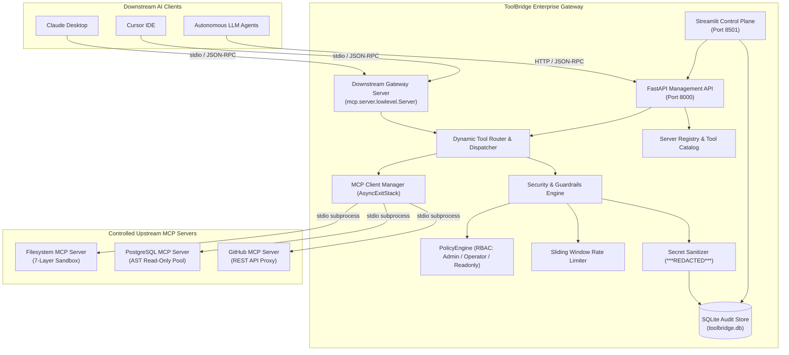

# ToolBridge: Enterprise Model Context Protocol (MCP) Gateway

[](https://www.python.org/downloads/release/python-3120/)
[](https://modelcontextprotocol.io/)
[](https://fastapi.tiangolo.com/)
[](https://streamlit.io/)
[]()
[]()

> **ToolBridge** is a centralized, secure **Enterprise MCP Gateway** that connects multiple upstream Model Context Protocol (MCP) servers and multiplexes their tools to downstream AI applications (Claude Desktop, Cursor, IDEs, autonomous LLM agents) through a single, unified, namespaced MCP interface.

---

## 📑 Table of Contents

- [Architectural Overview](#-architectural-overview)
- [Key Features](#-key-features)
- [Security Guardrails & Defense-in-Depth](#-security-guardrails--defense-in-depth)
- [Prerequisites & Environment Setup](#-prerequisites--environment-setup)
- [Running the Gateway & Services](#-running-the-gateway--services)
  - [1. Downstream MCP Gateway (stdio)](#1-downstream-mcp-gateway-stdio)
  - [2. FastAPI Management & Audit API](#2-fastapi-management--audit-api)
  - [3. Streamlit Observability Dashboard](#3-streamlit-observability-dashboard)
- [Claude Desktop Integration](#-claude-desktop-integration)
- [End-to-End Demo Workflow](#-end-to-end-demo-workflow)
- [Test Suite & Quality Verification](#-test-suite--quality-verification)
- [Honest Production Readiness & Limitations](#-honest-production-readiness--limitations)
- [Technical Interview Defense Guide](#-technical-interview-defense-guide)

---

## 🏛️ Architectural Overview

ToolBridge simultaneously acts as:
1. **An MCP Client** to upstream servers (Filesystem, PostgreSQL, GitHub) via isolated asynchronous subprocesses over standard IO (`stdio`).
2. **An MCP Server** to downstream AI clients exposing a unified, aggregated, namespaced tool catalog.



---

## 🌟 Key Features

- **Dynamic Tool Discovery**: Queries `tools/list` on all connected upstreams at boot time and registers dynamic JSON schemas at runtime.
- **Collision Prevention via Namespacing**: Re-maps upstream tools to `<server_id>__<tool_name>` (e.g. `filesystem__read_file`, `postgres__execute_query`, `github__list_issues`).
- **MCP Python SDK v2 Native**: Built strictly on official `mcp==2.3.0` using `mcp.server.lowlevel.Server` and `mcp.client.stdio.stdio_client`.
- **Pre-flight JSON Schema Validation**: Validates arguments against discovered schemas via `jsonschema` before passing payloads to upstreams.
- **Fault-Tolerant Concurrency**: Upstream failures, timeouts, and disconnects are cleanly trapped. The gateway never crashes if an upstream drops.
- **Full Observability & Control Plane**:
  - FastAPI management service with RBAC (`ADMIN`, `OPERATOR`, `READONLY`).
  - Interactive Streamlit dashboard with tool runner, live audit logs, and metrics.
  - Secret scrubbing redacting tokens and passwords before writing to SQLite.

---

## 🛡️ Security Guardrails & Defense-in-Depth

### 1. Filesystem Sandbox (`FilesystemGuard`)
Guards file access within an isolated workspace directory (`./workspace_sandbox`):
- **Null-Byte Rejection**: Detects `\0` bytes to block C string truncation attacks.
- **Absolute Path Prohibition**: Blocks `/etc/passwd`, `C:\Windows`, UNC shares (`\\server\share`).
- **Multiple Dots Neutralization**: Rejects `.../` traversal patterns.
- **Canonical Containment**: Verifies `resolved_path.relative_to(sandbox_root.resolve())`.
- **Symlink Escape Defense**: Asserts symlink targets resolve within the sandbox.
- **Windows Device Name Defense**: Blocks reserved names (`CON`, `PRN`, `AUX`, `NUL`, `COM1-9`, `LPT1-9`).
- **Atomic Writes**: Writes to `.tmp` files and atomically replaces target files to prevent partial corruptions.

### 2. SQL AST Inspection (`SQLSecurityGuard`)
Guards database queries with Abstract Syntax Tree parsing (`sqlparse`):
- **Whitelist Enforcement**: Permitted command type is strictly `SELECT`. Rejects `INSERT`, `UPDATE`, `DELETE`, `DROP`, `ALTER`, `TRUNCATE`.
- **Stacked Query Defense**: Prevents multi-statement attacks (`SELECT 1; DROP TABLE users;`).
- **Dangerous Clause Rejection**: Blocks table-creation attempts (`SELECT ... INTO`).
- **Dangerous Function Blacklist**: Blocks functions such as `pg_sleep`, `pg_terminate_backend`, `dblink`.
- **Read-Only Transaction Isolation**: Database connection pool executes under `SET SESSION CHARACTERISTICS AS TRANSACTION READ ONLY`.

### 3. Role-Based Access Control (`PolicyEngine`)
- **Tiers**: Categorizes tools into `SAFE` (read-only) and `SENSITIVE` (state mutations like `filesystem__write_file`).
- **Roles**:
  - `ADMIN`: Full access to all tools and configuration endpoints.
  - `OPERATOR`: Safe operations + sensitive file writes.
  - `READONLY`: Strictly read-only operations. Sensitive calls trigger HTTP 403 Forbidden.

### 4. Secret Sanitization (`SecretSanitizer`)
Automatically masks passwords, GitHub Personal Access Tokens (`ghp_`), Bearer tokens, and sensitive keys with `***REDACTED***` in audit logs and error messages.

---

## 🚀 Prerequisites & Environment Setup

### Prerequisites
- **Python 3.12+** (tested on Python 3.12.10)
- **Git**
- Optional: PostgreSQL 14+ (or use the built-in SQLite database backend for local zero-dependency testing)

### Setup Instructions

1. **Clone the repository**:
   ```bash
   git clone https://github.com/your-org/toolbridge.git
   cd toolbridge
   ```

2. **Create and activate virtual environment**:
   ```powershell
   # Windows PowerShell
   py -3.12 -m venv .venv
   .\.venv\Scripts\Activate.ps1

   # Linux / macOS
   python3.12 -m venv .venv
   source .venv/bin/activate
   ```

3. **Install dependencies**:
   ```bash
   pip install --upgrade pip
   pip install -e ".[dev]"
   ```

4. **Configure environment variables**:
   ```bash
   cp .env.example .env
   ```
   *(Optional: Set `GITHUB_PERSONAL_ACCESS_TOKEN` in `.env` if you wish to query private GitHub repositories).*

---

## 💻 Running the Gateway & Services

### 1. Downstream MCP Gateway (`stdio`)
To run ToolBridge as a stdio server for Claude Desktop, Cursor, or AI agent processes:
```bash
python -m toolbridge.server.gateway
```
*Note: ToolBridge will start, connect to all configured upstream servers, discover tools, and wait for JSON-RPC 2.0 messages over standard input.*

### 2. FastAPI Management & Audit API
Run the REST API management service with auto-reload:
```bash
uvicorn toolbridge.api.app:app --host 127.0.0.1 --port 8000
```
Interactive Swagger API documentation is available at:
👉 **`http://127.0.0.1:8000/docs`**

**Default API Authentication Keys:**
- Admin: `tb-admin-key-999` (Role: `admin`)
- Operator: `tb-operator-key-555` (Role: `operator`)
- Read-Only: `tb-readonly-key-111` (Role: `readonly`)

### 3. Streamlit Observability Dashboard
Launch the control plane and interactive tool execution UI:
```bash
streamlit run src/toolbridge/dashboard/app.py
```
Dashboard opens in your browser at:
👉 **`http://localhost:8501`**

---

## 🤖 Claude Desktop Integration

To expose all ToolBridge upstream tools (Filesystem, PostgreSQL, GitHub) to **Claude Desktop**, add the following configuration to your `claude_desktop_config.json`:

**Windows Path:** `%APPDATA%\Claude\claude_desktop_config.json`  
**macOS Path:** `~/Library/Application Support/Claude/claude_desktop_config.json`

```json
{
  "mcpServers": {
    "toolbridge": {
      "command": "d:\\Personal Projects\\Toolbridge - mcp gateway\\.venv\\Scripts\\python.exe",
      "args": [
        "-m",
        "toolbridge.server.gateway"
      ],
      "env": {
        "FILESYSTEM_SANDBOX_ROOT": "./workspace_sandbox",
        "GITHUB_PERSONAL_ACCESS_TOKEN": ""
      }
    }
  }
}
```

Restart Claude Desktop, and click the hammer icon 🔨 to verify that all 11 namespaced tools appear automatically!

---

## 🧪 End-to-End Demo Workflow

### 1. Check Gateway Health
```bash
curl -X GET "http://127.0.0.1:8000/health"
```
**Response:**
```json
{
  "status": "healthy",
  "gateway": "ToolBridge Enterprise Gateway",
  "version": "0.1.0",
  "uptime_seconds": 12.4
}
```

### 2. Discover Namespaced Tools
```bash
curl -X GET "http://127.0.0.1:8000/api/v1/tools" \
     -H "X-API-Key: tb-readonly-key-111"
```
**Response (Sample):**
```json
{
  "total": 11,
  "tools": [
    {
      "namespaced_name": "filesystem__read_file",
      "server_id": "filesystem",
      "sensitivity_tier": "safe",
      "description": "Read file contents securely within designated workspace."
    },
    {
      "namespaced_name": "filesystem__write_file",
      "server_id": "filesystem",
      "sensitivity_tier": "sensitive",
      "description": "Atomically write or overwrite a file inside the designated sandbox."
    },
    {
      "namespaced_name": "postgres__execute_query",
      "server_id": "postgres",
      "sensitivity_tier": "safe",
      "description": "Execute an approved read-only SELECT query against PostgreSQL with AST validation."
    }
  ]
}
```

### 3. Invoke Tool: Read-Only Query (Success)
```bash
curl -X POST "http://127.0.0.1:8000/api/v1/tools/invoke" \
     -H "X-API-Key: tb-readonly-key-111" \
     -H "Content-Type: application/json" \
     -d '{
       "tool_name": "filesystem__list_directory",
       "arguments": {"path": ""}
     }'
```

### 4. Security Test: Sensitive Tool Attempt by Read-Only User (Blocked by RBAC)
```bash
curl -X POST "http://127.0.0.1:8000/api/v1/tools/invoke" \
     -H "X-API-Key: tb-readonly-key-111" \
     -H "Content-Type: application/json" \
     -d '{
       "tool_name": "filesystem__write_file",
       "arguments": {"path": "test.txt", "content": "attack"}
     }'
```
**Response:**
```json
{
  "detail": "Role 'readonly' is not permitted to execute sensitive tool 'filesystem__write_file'."
}
```
*(HTTP Status: `403 Forbidden` — an audit record is logged with status `UNAUTHORIZED`).*

### 5. Security Test: SQL Injection Blocked by AST Guard
```bash
curl -X POST "http://127.0.0.1:8000/api/v1/tools/invoke" \
     -H "X-API-Key: tb-admin-key-999" \
     -H "Content-Type: application/json" \
     -d '{
       "tool_name": "postgres__execute_query",
       "arguments": {"query": "SELECT * FROM users; DROP TABLE logs;"}
     }'
```
**Response:**
```json
{
  "detail": "SQLSecurityError: Multiple SQL statements detected. Only single statements permitted."
}
```

---

## 🔬 Test Suite & Quality Verification

ToolBridge includes a comprehensive automated test suite consisting of unit tests, security penetration tests, and end-to-end integration tests using separate downstream MCP clients.

Run the full test suite:
```powershell
.\.venv\Scripts\pytest -v
```

**Test Summary:**
```text
============================= test session starts =============================
platform win32 -- Python 3.12.10, pytest-9.2.0
plugins: anyio-4.16.0, asyncio-1.4.1.post1
collected 105 items

tests\integration\test_api.py .........................                  [ 23%]
tests\integration\test_client_manager.py ...                             [ 26%]
tests\integration\test_downstream_gateway.py .                           [ 27%]
tests\integration\test_filesystem_server.py ...............              [ 41%]
tests\integration\test_postgres_server.py ..............                 [ 55%]
tests\security\test_filesystem_guard.py .................s.              [ 73%]
tests\security\test_sql_guard.py .............................           [100%]

======================= 104 passed, 1 skipped in 37.37s =======================
```
*(Note: 1 test in `test_filesystem_guard.py` is skipped on Windows when unprivileged symlink creation privilege `SeCreateSymbolicLinkPrivilege` is not enabled, matching standard OS security behavior).*

---

## ⚠️ Honest Production Readiness & Limitations

To maintain professional engineering integrity, the following limitations should be evaluated before production deployment:

1. **In-Memory Rate Limiting**: The current `SlidingWindowRateLimiter` operates in-memory on a single Python process. If ToolBridge is scaled horizontally behind a round-robin load balancer, rate limits are not shared across nodes. Production requires a Redis-backed distributed token bucket.
2. **PostgreSQL Setup Script**: The provided `scripts/setup_postgres_db.sql` creates a dedicated `mcp_readonly` user. In enterprise environments, this must be provisioned via Terraform / CloudFormation with secrets retrieved from AWS Secrets Manager or HashiCorp Vault.
3. **Transport Protocol**: Downstream clients currently connect via `stdio` or HTTP management endpoints. For high-throughput cloud microservices, an SSE (Server-Sent Events) or WebSocket transport with mTLS termination is recommended.
4. **Persistent Server Registry**: Server configurations are currently loaded during gateway boot. Multi-tenant enterprise environments should store server configurations in a replicated database with dynamic add/remove hooks.

---

## 📚 Technical Interview Defense Guide

For comprehensive interview preparation covering the low-level MCP protocol, async multiplexing, AST SQL tokenization, and filesystem containment proofs, refer to:
👉 **[`docs/interview_guide.md`](docs/interview_guide.md)**
